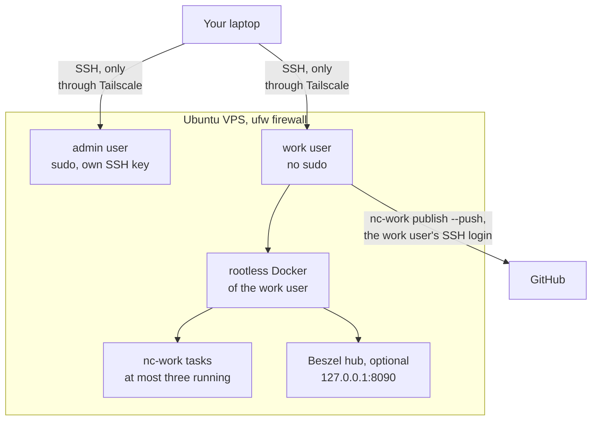
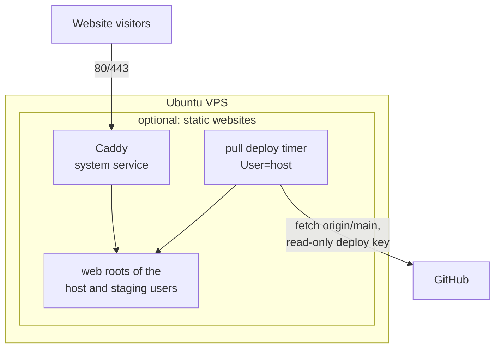
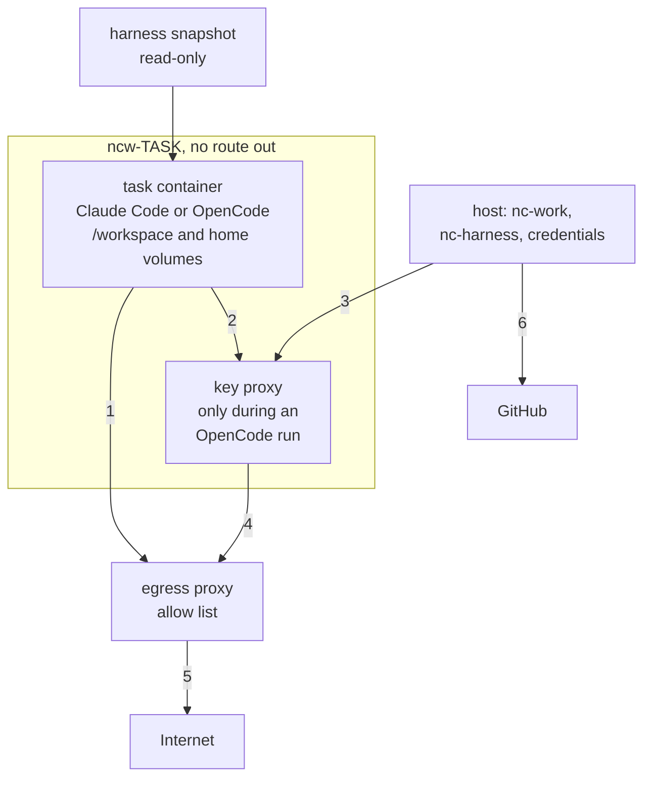

# nc-infra

Infrastructure for running coding agents (Claude Code and OpenCode) on your own Linux server. The core is `nc-work`, a host-side launcher that gives every agent task its own rootless Docker container, behind an egress proxy with an allow list and without credentials inside. Around it: a setup guide for the server and optional monitoring.

nc-infra works together with [nc-harness](https://github.com/iAmSerathion/nc-harness), which provides the agent rules, the model policy, the shared memory and delegation (`nc delegate`). [herdr-nc](https://github.com/iAmSerathion/herdr-nc) configures the Herdr desktop app on your laptop; its menu entries "Claude (isolated)" and "OpenCode (isolated)" run `nc-work here` on the server, and its cards show the usage of isolated sessions.

## Terms

- **Task** (nc-work task): one unit of agent work, with its own task container, internal network, egress proxy and volumes.
- **Task container**: the container in which Claude Code or OpenCode runs.
- **Profile**: one JSON file per project: folder, GitHub repository, Node version, preview ports, allowed internet targets.
- **Egress proxy**: the task's only way to the internet; it allows the DNS names of the profile and nothing else.
- **Key proxy**: holds the OpenRouter key during an OpenCode run, outside the task container.
- **Harness snapshot**: a read-only copy of nc-harness, with the overlay's `AGENTS.md` and `models.yaml` baked in.
- **Overlay**: `~/.nc/overlay`, usually a link to your private overlay repo with `AGENTS.md`, `models.yaml` and `profiles/`.
- **Shared memory**: notes that all agents read and add to (nc-harness `nc memory`), a Git checkout on the host.
- **Broker and mailbox**: each task has a mailbox folder; `nc-work broker` on the host serves `nc delegate` and `nc memory add` requests from it.
- **Work user, admin user**: the server's two login users; agents run only as the work user, which has no `sudo`.

## What is in this repository

| Path | Content |
|---|---|
| [`work-environments/`](work-environments/README.md) | `nc-work` (`bin/nc-work`), the image (`images/`), the key proxy (`keyproxy/`), example profiles (`profiles/`) and the tests |
| [`docs/design.md`](docs/design.md) | the full reference: how `nc-work` behaves and why |
| [`docs/vps-setup.md`](docs/vps-setup.md) | setting up and hardening the server underneath |
| [`monitoring/beszel/`](monitoring/beszel/README.md) | optional Beszel monitoring that runs without root |

## Architecture

### The server

Users, access and tasks:

The optional website hosting on the same server:

Agents run as the work user and can never become root.

- **Access**: the admin user is used by a human; it has `sudo` and its own SSH key that no agent can reach. The work user has no `sudo` and runs rootless Docker, `nc-work` and the nc-harness checkout. SSH is reachable only through Tailscale.
- **Firewall**: `ufw` denies incoming traffic except on `tailscale0` and `41641/udp` (direct Tailscale connections); `80/tcp` and `443/tcp` only when the server hosts websites.
- **Hosting (optional)**: `host` and `staging` are service users that own the live and staging web roots. Caddy serves them. A site goes live by pull deploy: a timer fetches the default branch from GitHub, so agents never get a key to the server.
- **Ports**: container ports are published on `127.0.0.1` only and reached through an SSH tunnel from your laptop.

Details and commands: [`docs/vps-setup.md`](docs/vps-setup.md) (hosting in [section 4](docs/vps-setup.md#4-optional-static-websites-with-caddy)).

### One task

1. The agent sends HTTP(S) through the egress proxy at `egress:3128`.
2. The agent calls the key proxy with a placeholder key.
3. The host passes the key to the key proxy on stdin.
4. The key proxy sends the request on with the real OpenRouter key, through the egress proxy.
5. The egress proxy lets through allow-listed DNS names only.
6. The host exports the task branch and pushes it to GitHub over SSH.

The task container sits on its own internal Docker network (`ncw-TASK` in the diagram); its only way out is the egress proxy. The project comes in from the last commit of its checkout, and the agent works on the branch `nc-work/<task>`. Pushing to GitHub happens on the host, never in the container. Each flow (create, session, publish, broker) is walked through in [`work-environments/README.md`](work-environments/README.md#how-it-works).

## Trust model

| Item | Where it is / what the agent can do |
|---|---|
| The agent can reach | the allow-listed DNS names of its profile (ports 80/443), the key proxy of a running OpenCode run, its own workspace and home volumes, the read-only harness snapshot, a read-only view of the shared memory, its memory outbox (writable, applied only by `nc-work memory-apply`), and its mailbox to the broker |
| The agent cannot reach | other hosts, private networks, Tailscale, localhost, the server's public addresses, the Docker socket, the host home, an SSH agent, GitHub credentials |
| Claude token | on the host in `~/.local/share/nc-work/auth/` (mode 600); passed to Claude per session through the environment of `docker exec`, so a process in the same container can read it while the session runs |
| OpenRouter keys | on the host in `~/.config/nc-harness/secrets.env`; one key per run goes on stdin into the key proxy and is in no task container; which key is chosen by the model policy of the project. While an OpenCode run is active, any process in that task can make model calls through the key proxy, limited by the key's daily limit at OpenRouter and, with the clients key, by its allow list of models |
| GitHub | the work user's own SSH login on the host; `nc-work publish` checks the exported objects in a fresh bare repository and pushes only the task branch |
| Data from a task | Git bundles, `RESULT.md` and mailbox requests are treated as data: sizes are limited, links are not followed, and nothing from a task is run on the host |

The isolation protects the host and your accounts against the task container. It does not protect against the host user or root, containers share the host kernel (they are not VMs), and an allow-listed service can still receive data. The full list of limits: [`docs/design.md`](docs/design.md#limits-and-operation).

## Getting started

1. Set up the server: [`docs/vps-setup.md`](docs/vps-setup.md) (users, firewall, Tailscale-only SSH, rootless Docker, optional Caddy and pull deploy).
2. Install nc-harness at `~/projects/personal/nc-harness` (see its README).
3. Install `nc-work` and build the image ([Install](work-environments/README.md#install)), add a profile for your project ([Profiles and the overlay](work-environments/README.md#profiles-and-the-overlay)) and create your first task ([Quick start](work-environments/README.md#quick-start)).
4. Optional: monitoring with [`monitoring/beszel/`](monitoring/beszel/README.md).

Private profiles and rules never go into this repository. They go into the overlay, `~/.nc/overlay`.

## Where to read more

- [`work-environments/README.md`](work-environments/README.md): flows, install, commands of `nc-work`.
- [`docs/design.md`](docs/design.md): every command and rule in detail, including the [broker](docs/design.md#broker-nc-work-broker), the [key proxy](docs/design.md#key-proxy) and [publishing](docs/design.md#github-without-credentials-in-the-container).
- [`docs/vps-setup.md`](docs/vps-setup.md): the server.
- Sibling repositories: [nc-harness](https://github.com/iAmSerathion/nc-harness), [herdr-nc](https://github.com/iAmSerathion/herdr-nc), [nc-memory-template](https://github.com/iAmSerathion/nc-memory-template).

## Licence

MIT, see [LICENSE](LICENSE).
