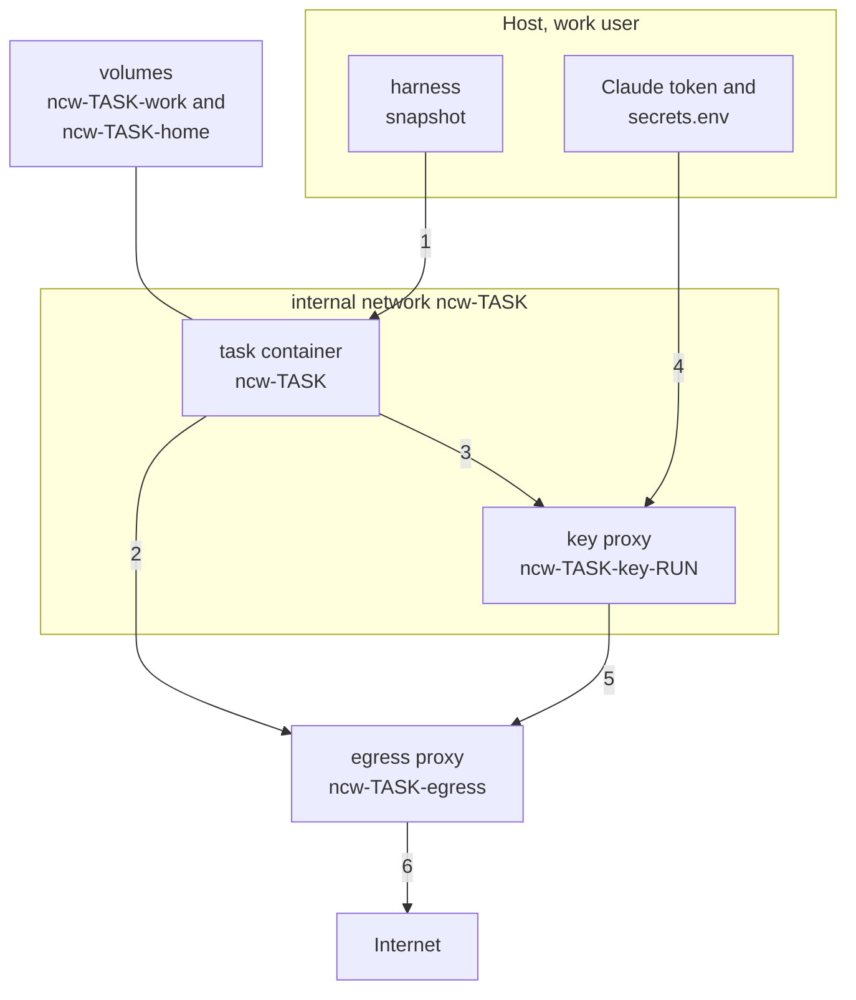
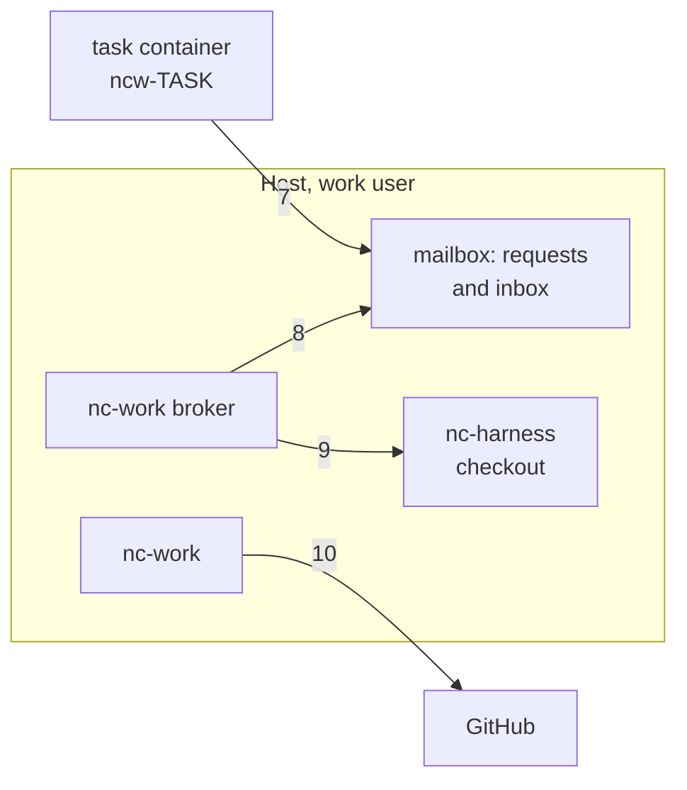
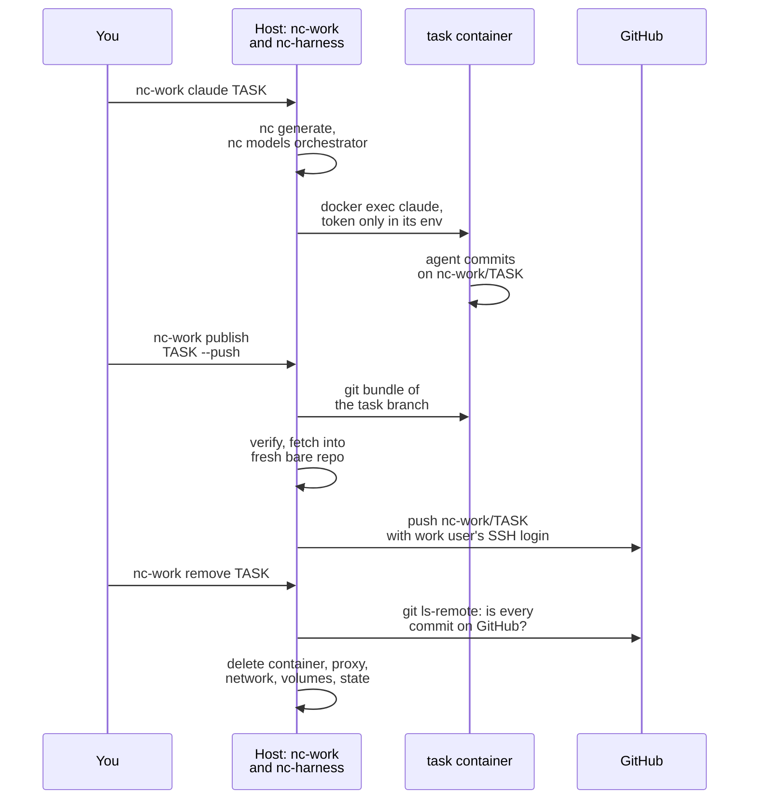

# nc-work: isolated work environments for coding agents

`bin/nc-work` runs Claude Code and OpenCode in one rootless Docker container per task, on a Linux server. Each task has its own internal network, its own workspace and home volumes, a read-only harness snapshot of [nc-harness](https://github.com/iAmSerathion/nc-harness), and no credentials. Its only way to the internet is an egress proxy with an allow list. GitHub pushes happen on the host, the Claude token is passed per session, and the OpenRouter key stays in a key proxy outside the task container.

`nc-work` is a single Python script that runs on the host as the work user. It is never installed or mounted in a container. The full reference is [`docs/design.md`](../docs/design.md).

## Terms

- **Task**: one unit of agent work: a task container, its internal network, its egress proxy and its volumes. **Task container**: the container in which the agent runs.
- **Profile**: one JSON file per project (see [Profiles and the overlay](#profiles-and-the-overlay)).
- **Harness snapshot**: a read-only copy of a committed nc-harness checkout, with the overlay's `AGENTS.md` and `models.yaml` baked in.
- **Overlay**: the folder `~/.nc/overlay`, usually a link to your private overlay repo; it holds your own profiles and rules.
- **Shared memory**: notes that all agents read and add to (nc-harness `nc memory`); `nc-work` reads its Git checkout on the host.
- **Broker and mailbox**: each task has a mailbox folder on the host; `nc-work broker` reads requests from it and writes answers back.
- **Worker**: a task created for `nc delegate`; its agent writes a report to `/home/agent/.nc/RESULT.md`, which comes back to the requester with the branch.
- **Orchestrator**: the main Claude session of a task; `nc models orchestrator` (nc-harness) names its model and effort.
- **herdr**: the Herdr desktop app on your laptop, configured by [herdr-nc](https://github.com/iAmSerathion/herdr-nc); it starts sessions on the server and shows their usage on cards.

## Architecture

The task container and its network:



1. The harness snapshot is mounted read-only at `/opt/nc-harness`.
2. The task container reaches the egress proxy through `HTTP_PROXY=http://egress:3128`.
3. The task container calls the key proxy with the placeholder key `nc-keyproxy`.
4. The key proxy gets one key on stdin.
5. The key proxy opens `CONNECT openrouter.ai:443` through the egress proxy.
6. The egress proxy lets through only the allow list.

The broker and publishing, on the host:



7. The task container writes requests into the mailbox.
8. The broker reads requests from the mailbox and writes answers back.
9. The broker calls `nc delegate` and `nc memory apply` in the nc-harness checkout.
10. `nc-work publish` bundles, verifies and pushes to GitHub.

- **Task container** `ncw-<task>`: runs as uid 1000 with a read-only root file system, no Linux capabilities, `no-new-privileges`, at most 2 CPUs, 4 GiB RAM and 512 processes (fixed in `bin/nc-work`). The project lives in the volume `ncw-<task>-work` at `/workspace`, the agent's home in `ncw-<task>-home`. It sits on the internal network `ncw-<task>`, which has no route out.
- **Egress proxy** `ncw-<task>-egress`: Squid in the same image, on both the task network (alias `egress`) and the bridge `ncw-egress`. It allows only the DNS names in the profile's `allowed_domains`, on ports 80 and 443, and denies private ranges, Tailscale (`100.64.0.0/10`), localhost and the server's own public addresses (read with `ip -j addr` when the task is created). The same container relays the profile's preview ports from `127.0.0.1` on the host to the agent.
- **Key proxy** `ncw-<task>-key-<run>`: started for each OpenCode run (`keyproxy/keyproxy.py`, Python standard library only). It receives the OpenRouter key on stdin, accepts only `POST /api/v1/chat/completions`, adds the key and forwards to `openrouter.ai` through the egress proxy. It is removed when the run ends.
- **Harness snapshot**: provides the rules, skills, OpenCode configuration and `nc` inside the container.
- **Broker**: `nc-work broker`, a foreground process on the host that serves `nc delegate` and `nc memory add` from inside tasks through a per-task mailbox.

## How it works

### Creating a task

`nc-work create PROFILE TASK` reads the profile, refuses if the checkout `~/projects/<path>` has uncommitted changes, and creates the volumes, the internal network, the egress proxy and the task container. Only committed data comes in: the host bundles `HEAD`, the container clones the bundle and switches to `nc-work/<task>`, and the Git remote is removed. Untracked `.env` files, dependencies and personal configuration stay on the host. At most three task containers run at the same time; a fourth `create` ends with exit 3.

New tasks use the current harness snapshot (`nc-work snapshot` publishes one). A task keeps its snapshot and image for its whole life; a new snapshot applies to tasks created afterwards.

### A session



The host column stands for `nc-work` and the host's nc-harness checkout: `nc generate` (subagent files) and `nc models orchestrator` run in nc-harness, every other host step is `nc-work`.

**Claude**: `nc-work claude TASK` reads the Claude token from `~/.local/share/nc-work/auth/`, generates the subagent files from the host's nc-harness checkout (`nc generate`, model and effort per role from `models.yaml`), and starts Claude with the orchestrator's model and effort from `nc models orchestrator`. The token is passed through the environment of `docker exec`, never as an argument and never in the container configuration.

**OpenCode**: `nc-work opencode TASK` works in five steps:

1. It asks the host's harness for the model policy of the project (`nc models --json --path`).
2. The policy picks the key from `secrets.env`: `OPENROUTER_API_KEY_CLIENTS` if the project denies free models or requires `no-training` (the default `models.yaml` does so under `~/projects/clients/`), otherwise `OPENROUTER_API_KEY`.
3. The policy fails closed: if it cannot be read, or the clients key is missing, OpenCode does not start. There is never a fallback to the other key.
4. It starts the key proxy with that key on stdin. OpenCode sees only `OPENROUTER_API_KEY=nc-keyproxy`.
5. After the run, it ends every process of that run in the container and removes the key proxy.

**`nc-work here`**: picks or creates a task for the project of the current folder and starts Claude (`--runtime opencode` for OpenCode). herdr's menu entries "Claude (isolated)" and "OpenCode (isolated)" call it.

### Publishing

`nc-work publish TASK` is a dry run; `--push` writes. The host exports the task branch as a bundle, checks it in a fresh bare repository (container Git configuration and hooks are never run on the host) and pushes only `nc-work/<task>` to the repository named in the profile, with the work user's SSH login. Other branches, force push and merge are not possible through this command. Opening a pull request is up to you.

### Broker: `nc delegate` and `nc memory add` from inside a task

Every task created without `--worker` gets a mailbox: a writable `/opt/nc-requests` and a read-only `/opt/nc-inbox`, backed by `~/.local/share/nc-work/broker/<task>/` on the host. Inside the task, `nc delegate` and `nc memory add` (nc-harness) put a request into the mailbox. `nc-work broker`, running in the foreground (for example in a herdr pane), reads it as data and hands it to the host's harness:

- **delegate**: `nc delegate --broker` checks role, model and policy and creates a worker task with `nc-work create PROFILE WORKER --worker --from-task TASK`, starting from the requester's last commit. When the worker is done, the broker puts the result, `RESULT.md` and the branch as a bundle into the requester's inbox. Nothing is merged or run.
- **memory**: `nc memory apply --broker` writes the note into the project's file in the shared memory, at most 20 new or replaced notes per task and day. Each stored note is shown in the broker's pane.

Requests are size-limited, links and special files are deleted unread, and project, path and token always come from the task record, never from the request. Without the broker, `nc memory add` falls back to the task's memory outbox, which `nc-work memory-apply` applies.

### The harness snapshot and the overlay

`nc-work snapshot` takes `git archive` of the harness `HEAD` (refused while the checkout has uncommitted changes) and adds `AGENTS.md` and `models.yaml` from the overlay over the public defaults. The tag is the harness commit plus a short hash of the overlay files, so a changed overlay gives a new snapshot. Policy decisions on the host (which key, which subagent models) always read the live host checkout and overlay, never the snapshot.

## Requirements

- A Linux host, written for Ubuntu 24.04 (see [`docs/vps-setup.md`](../docs/vps-setup.md)), with Python 3 and rootless Docker for an unprivileged user: `uidmap`, lingering on (`loginctl enable-linger`, so user services run without a login), and `DOCKER_HOST=unix:///run/user/<uid>/docker.sock` set for that user.
- `~/.local/bin` on the work user's `PATH`.
- nc-harness cloned at exactly `~/projects/personal/nc-harness` and installed (`./install.sh`). The path is fixed (`HARNESS` in `bin/nc-work`); a checkout anywhere else is not found. `nc-work` calls its `bin/nc` on the host for the model policy, subagent files, memory and delegation. It reads the shared memory checkout at `$NC_HOME/memory` (default `~/.nc/memory`).
- Projects as Git checkouts below `~/projects`, one profile per project.
- For OpenCode: OpenRouter keys in `~/.config/nc-harness/secrets.env` (see nc-harness).
- For Claude: a Claude subscription and Claude Code on the host at `~/.local/bin/claude` (`nc-work auth-login` runs its `setup-token`).
- For `publish --push` and `remove`: an SSH login of the work user with access to the project's GitHub repository.

## Install

```sh
git clone https://github.com/iAmSerathion/nc-infra.git ~/projects/personal/nc-infra
ln -s ~/projects/personal/nc-infra/work-environments/bin/nc-work ~/.local/bin/nc-work
```

Build the image once. The binaries are not in Git; only the checksums of Claude Code and OpenCode are.

1. Node and Bun: the official Linux x64 release archives of the Node versions in `VERSIONS` in `bin/nc-work` and of Bun 1.4.4. Verify each against the checksum file published with its release. Unpack them without their top folder, so that the tree looks like this:

   ```
   images/toolchains/node/24.22.3/bin/node
   images/toolchains/node/20.20.2/bin/node
   images/toolchains/node/26.13.1/bin/node
   images/toolchains/bun/1.4.4/bin/bun
   ```

   The container's `PATH` expects exactly `/opt/toolchains/node/<version>/bin` and `/opt/toolchains/bun/1.4.4/bin`.
2. Claude Code and OpenCode: the Linux x64 binaries at `images/claude` and `images/opencode`. They must match `images/claude.sha256` and `images/opencode.sha256`. `images/opencode` is the unpacked binary from `opencode-linux-x64.tar.gz` of the OpenCode GitHub release; its version must match `pins.txt` in nc-harness. `images/claude` is Anthropic's native Linux x64 Claude Code binary. The versions in the current image are listed in [`docs/design.md`](../docs/design.md#profiles).
3. Build and point `nc-work` at the new tag (the tag is a date, `YYYY-MM-DD`):

   ```sh
   cd ~/projects/personal/nc-infra/work-environments
   sha256sum -c images/claude.sha256 images/opencode.sha256
   docker build -t nc-work:<date> images
   ```

   Then set `IMAGE` in `bin/nc-work` to `nc-work:<date>`.

Then `nc-work snapshot` publishes the harness snapshot for new tasks.

## Profiles and the overlay

A profile (`profiles/<id>.json`) names the project folder below `~/projects` (`path`), its GitHub repository (`github`), Node version, preview ports and allowed internet targets (`allowed_domains`). A `limits` entry is descriptive only: every task gets 2 CPUs, 4 GiB RAM and 512 processes, fixed in `bin/nc-work`. The shipped profiles are examples; copy one and adapt it.

Your own files go into one fixed folder, the overlay `~/.nc/overlay`:

| In `~/.nc/overlay` | Effect |
|---|---|
| `profiles/<id>.json` | added to the shipped profiles; wins on the same id |
| `AGENTS.md`, `models.yaml` | baked into the harness snapshot instead of nc-harness' public defaults (regular files only, at most 256 KiB, committed); an overlay without `models.yaml` is refused |

Nothing else in the overlay reaches a container. No environment variable moves the overlay.

## Quick start

First add a profile for a project you have as a clean Git checkout below `~/projects`: copy `profiles/example-site.json` to `~/.nc/overlay/profiles/<id>.json`, and set `id` to `<id>`, `path` to the checkout's folder below `~/projects` and `github` to its repository. Then:

```sh
nc-work profiles                         # <id> is listed
nc-work auth-login                       # once: Claude token for all projects
nc-work create <id> first                # task "first" from the last commit of the checkout
nc-work claude first                     # or: nc-work opencode first
nc-work publish first                    # dry run; --push pushes the task branch from the host
nc-work remove first
```

To see a development server in the container, run it on `0.0.0.0` on one of the profile's preview ports and read the host port from `nc-work status TASK` (for example `3000/tcp -> 127.0.0.1:32771`). Then, from your laptop, tunnel to it: `ssh -N -L 8080:127.0.0.1:32771 <server>`, where `<server>` is the server's SSH host name (see [`docs/vps-setup.md`](../docs/vps-setup.md)).

## Commands

| Command | What it does |
|---|---|
| `profiles [--json]` | list the profiles (overlay and shipped); `--json` prints one line `[{"id","path","github"}]` |
| `create PROFILE TASK [--offline]` | create a task from the last commit of the project's checkout; `--offline` gives it no network |
| `create PROFILE TASK --worker [--from-task REQUESTER]` | a worker task for `nc delegate`: no memory, no mailbox; `--from-task` starts from the requester's last commit (exit 4 if refused) |
| `list` | the task containers and their state |
| `status TASK` | the task record and the assigned preview ports |
| `start TASK`, `stop TASK` | start or stop the container and its egress proxy; `stop` also removes key proxies |
| `enter TASK` | a shell in the container |
| `exec TASK -- COMMAND` | run one command in the container |
| `claude TASK` | start Claude in the task |
| `opencode [--stdin] TASK [-- ARGS]` | start OpenCode in the task; arguments after `--` go to `opencode`, `--stdin` passes piped input on |
| `here [PROFILE] [--runtime claude\|opencode]` | pick or create a task for the project of the current folder and start a session |
| `publish TASK [--push]` | push the task branch from the host; dry run without `--push` |
| `github-check TASK` | read-only check that the host can reach the project's repository |
| `auth-login [PROFILE]`, `auth-set [PROFILE]` | store a Claude token (browser flow or hidden prompt); without a profile it is the shared default |
| `auth-status PROFILE`, `auth-check TASK` | which token a project uses; which credentials exist in a container (presence only) |
| `snapshot` | publish a new harness snapshot for new tasks |
| `broker` | serve the mailboxes of all tasks in the foreground |
| `memory-apply [TASK ...]` | apply memory requests from the outbox (all tasks with memory without names) |
| `export TASK --out DIR` | worker tasks: collect the branch and `RESULT.md` onto the host |
| `feed --pid PID --script FILE [--since SIG] [--orch]` | usage data of an isolated Claude session for herdr's usage cards |
| `remove TASK ... [--force] [--discard-memory] [--discard-requests] [--delivered SHA]` | delete tasks; refused while work is not on GitHub or requests wait |

Exit codes: 0 success, 1 error, 3 three tasks already running (`create`), 4 refused by a rule (`create --from-task`). Runtime data lives in `~/.local/share/nc-work/` (task records, snapshots, tokens, proxy configs, memory views, subagent files, mailboxes).

## Security model

What the agent can and cannot reach, where each credential lives and what the isolation does not protect against is in the [trust model](../README.md#trust-model). Points specific to `nc-work`:

- No SSH key, SSH agent socket, GitHub token, Docker socket or host home is ever mounted into a task container.
- Everything from a task (Git bundles, `RESULT.md`, mailbox requests, memory outbox) is read as data on the host; nothing from a task is run there.
- A key proxy exists only while an OpenCode run is active; `stop` and the end of the run remove it.

The details: [network and profiles](../docs/design.md#profiles), [Claude token](../docs/design.md#claude-with-a-separate-model-token), [which key](../docs/design.md#which-key-default-and-title-model), [key proxy](../docs/design.md#key-proxy), [publishing](../docs/design.md#github-without-credentials-in-the-container), [limits](../docs/design.md#limits-and-operation).

## Tests

```sh
cd work-environments && python3 -m unittest tests/test_policy.py
```

Some tests read `/proc` and pass only on Linux. Contract tests with the real nc-harness are skipped without a harness checkout or `bun`.

## Where to read more

[`docs/design.md`](../docs/design.md) covers every command in detail: [`here`](../docs/design.md#starting-from-herdr-nc-work-here), [`remove`](../docs/design.md#removing-tasks-nc-work-remove), [shared harness](../docs/design.md#shared-harness), [shared memory](../docs/design.md#shared-memory), [subagents and orchestrator](../docs/design.md#subagents-and-orchestrator), [workers for `nc delegate`](../docs/design.md#workers-for-nc-delegate), [broker](../docs/design.md#broker-nc-work-broker), [OpenCode](../docs/design.md#opencode-with-openrouter-key) and [`feed`](../docs/design.md#usage-cards-in-herdr-nc-work-feed).

## Licence

MIT, see [LICENSE](../LICENSE).
